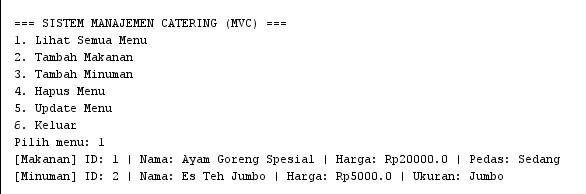
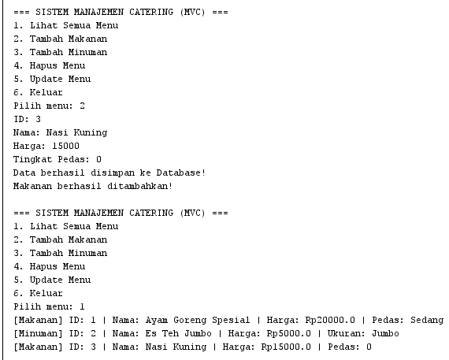
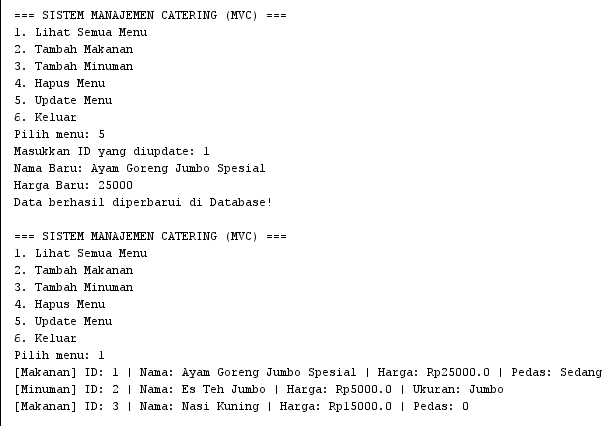
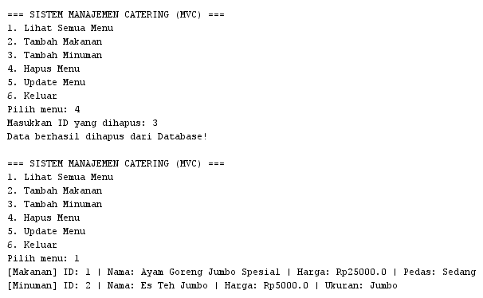

# Minpro-4-PBO-Catering

Aplikasi Manajemen Catering ini merupakan pengembangan kelanjutan dari Mini Project 3 yang telah dimigrasikan dari penyimpanan memori sementara (*ArrayList*) ke penyimpanan database terkonfigurasi permanen (*Data Persistence*) menggunakan **MySQL Database**, **JDBC (Java Database Connectivity)** berbasis **Prepared Statement**, serta arsitektur pola desain **DAO (Data Access Object)** dan **MVC (Model-View-Controller)**.

---

## 📌 Deskripsi Singkat Program
Aplikasi konsol interaktif ini dirancang untuk mengelola sistem data menu catering (Makanan dan Minuman) dengan fungsi CRUD (Create, Read, Update, Delete) secara penuh. Seluruh data yang diolah dihubungkan langsung secara *real-time* dengan database MySQL (`db_catering`). Data awal (*dummy data*) dimuat langsung secara otomatis dari file basis data SQL (`database_catering.sql`) saat fitur tampil menu pertama kali dijalankan tanpa perlu melakukan input manual dari awal.

---

##  Penjelasan Struktur Package
Proyek disusun terstruktur menggunakan arsitektur MVC yang dipadukan dengan layer DAO dan konfigurasi database:
- `config`: Berisi kelas `DatabaseConfig.java` yang bertanggung jawab mengelola dan menyediakan objek koneksi JDBC (`Connection`) ke server MySQL.
- `dao`: Berisi kelas `MenuDAO.java` yang mengisolasi seluruh logika eksekusi perintah SQL (Prepared Statement) ke database.
- `model`: Berisi *abstract class* `MenuCatering`, kelas turunan (`MenuMakanan` dan `MenuMinuman`), serta interface `OperasiData`.
- `controller`: Berisi kelas `CateringController.java` yang bertindak sebagai jembatan pengendali logika bisnis antara antarmuka pengguna (*View*) dan layer data (*DAO*).
- `view`: Berisi kelas `CateringView.java` untuk menangani antarmuka konsol interaktif, input pengguna, dan penanganan exception input (`InputMismatchException`).
- `com.mycompany.minprocatering4`: Berisi kelas `Main.java` yang berfungsi sebagai titik awal (*entry point*) eksekusi program.

---

##  Penjelasan Detail Alur Program
1. **Inisialisasi Koneksi Database**: Saat program dijalankan dari `Main.java`, aplikasi menyiapkan driver JDBC MySQL (`com.mysql.cj.jdbc.Driver`) yang telah dikonfigurasi pada `pom.xml`.
2. **Read Data Awal (Membaca dari Database)**:
   Pengguna memilih menu `1` (Lihat Semua Menu). `CateringView` memanggil controller yang meneruskan kueri ke `MenuDAO.getAll()`. Method ini mengeksekusi instruksi SQL `SELECT * FROM menu` dan membaca *dummy data* awal yang dimasukkan dari file `database_catering.sql`.
3. **Create Data (Tambah Menu ke Database)**:
   Pengguna memilih menu `2` (Tambah Makanan) atau `3` (Tambah Minuman). Data yang diinputkan pengguna dibentuk menjadi objek (`MenuMakanan`/`MenuMinuman`), lalu dikirim ke `MenuDAO.insert()` untuk disimpan secara permanen ke tabel database menggunakan perintah SQL `INSERT INTO`.
4. **Update Data (Memperbarui Database)**:
   Pengguna memilih menu `5` (Update Menu) dengan memasukkan ID target, nama baru, dan harga baru. `MenuDAO.update()` mengeksekusi perintah SQL `UPDATE menu SET ... WHERE id = ?`.
5. **Delete Data (Menghapus dari Database)**:
   Pengguna memilih menu `4` (Hapus Menu) dengan memasukkan ID. `MenuDAO.delete()` mengeksekusi perintah SQL `DELETE FROM menu WHERE id = ?`.
6. **Keluar**:
   Pengguna memilih menu `6` untuk menghentikan aplikasi secara aman.

---

##  Penjelasan Penerapan Encapsulation dan Inheritance
- **Encapsulation**:
  Setiap variabel/atribut pada kelas dasar (`id`, `nama`, `harga`) dideklarasikan dengan variabel `private`. Akses baca dan ubah nilai atribut dilakukan secara aman menggunakan metode *getter* dan *setter* (`getId()`, `setNama()`, `setHarga()`).
- **Inheritance**:
  - **Superclass**: `MenuCatering` sebagai kelas induk utama.
  - **Subclass**: `MenuMakanan` (menambahkan atribut `tingkatPedas`) dan `MenuMinuman` (menambahkan atribut `ukuran`) mewarisi atribut dan metode dasar dari `MenuCatering` dengan klausa `extends`.

---

##  Penjelasan Penerapan Polymorphism dan Abstraction
- **Abstraction**:
  Diterapkan menggunakan `abstract class MenuCatering` yang tidak dapat diinstansiasi secara langsung, serta memiliki *abstract method* `tampilDetail()` yang wajib diimplementasikan ulang oleh masing-masing kelas anak.
- **Polymorphism**:
  - **Method Overriding**: Method `tampilDetail()` di-*override* pada kelas `MenuMakanan` dan `MenuMinuman` untuk mencetak format spesifik sesuai atribut khusus masing-masing.
  - **Method Overloading**: Diterapkan pada metode `updateHarga()` di kelas `MenuCatering` yang memiliki dua bentuk variasi signature parameter (dengan atau tanpa diskon).

---

##  Penjelasan Penerapan JDBC (Java Database Connectivity)
Penerapan JDBC pada proyek ini difokuskan di dalam package `config` dan `dao`:
1. **Database Driver & Connection**: Kelas `DatabaseConfig` menggunakan method `DriverManager.getConnection(URL, USER, PASSWORD)` untuk membuka saluran komunikasi aktif dengan server MySQL pada basis data `db_catering`.
2. **Prepared Statement**: Setiap operasi *write/manipulation* data (INSERT, UPDATE, DELETE) pada kelas `MenuDAO` menggunakan objek `PreparedStatement`. Parameter kueri diikat menggunakan placeholder tanda tanya (`?`) seperti `ps.setString()`, `ps.setDouble()`, dan `ps.setInt()`. Penggunaan `PreparedStatement` ini menjamin keamanan dari serangan *SQL Injection* serta meningkatkan efisiensi eksekusi kueri.
3. **ResultSet Handling**: Operasi pembacaan data (READ) memanfaatkan objek `ResultSet` dari eksekusi kueri SQL untuk melakukan iterasi baris data (`rs.next()`), memetakan kolom database menjadi properti objek Java, dan memasukkannya ke dalam daftar koleksi (`List<MenuCatering>`).

---

## 📸 Tangkapan Layar (Screenshot Output)

### 1. Lihat Semua Menu (Read Data Awal dari File SQL)

### 2. Tambah Menu (Insert ke Database)

### 3. Update Menu (Update ke Database)

### 4. Hapus Menu (Delete dari Database)

